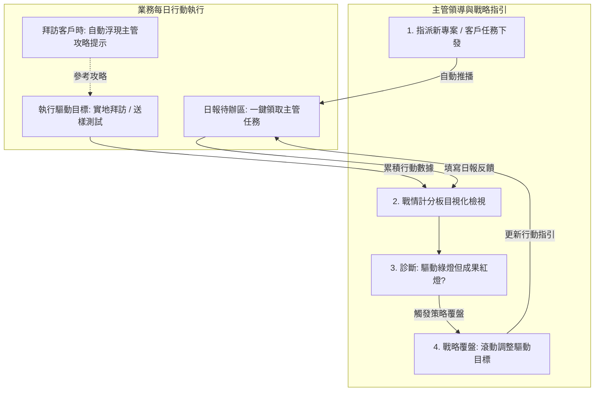
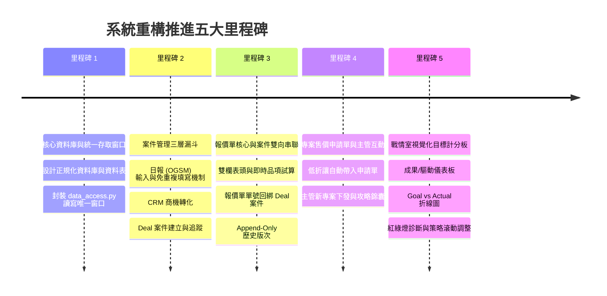

# 士林電機 FA 業務戰情與報價系統（PWA 整合版）系統架構與開發規劃書

## 一、系統概述與三大管理支柱

本系統專為士林電機 FA（工廠自動化/工控事業）業務團隊打造，將過去分散在 Streamlit 日報、桌機版 Python 與舊 PWA 的功能徹底重構，整合成一套**在電腦瀏覽器與手機 PWA 均能流暢運作的現代化 Web 應用程式**。

系統以三大核心支柱為基石，資料層嚴格落實 `data_access.py` 單一讀寫窗口，現階段相容本地快取與 Google 硬碟資料，未來可 100% 無痛直升公司伺服器的 **SQL Server Express**。

```mermaid
graph LR
    subgraph 支柱一: 案件管理 [支柱一：案件管理 (三層理論)]
        L1[第一層: 每日日報 OGSM] -->|挖掘商機| L2[第二層: 客戶商機 CRM]
        L2 -->|明確成案| L3[第三層: 專案案件 Deal]
    end

    subgraph 支柱二: 報價單管理 [支柱二：報價單管理]
        Q1[新建三段式報價單] --> Q2[財務嚴謹捨入計算]
        Q2 --> Q3[歷史版本不覆蓋 Append-Only]
    end

    subgraph 支柱三: 專案售價管理 [支柱三：專案售價申請單]
        SP1[折讓門檻觸發 / 手動申請]
        SP2[自動帶入: 案件競爭背景 + 報價經銷價]
        SP3[生成專案特價申請單與審核]
    end

    %% 連動關係
    L3 -.->|一鍵發起報價| Q1
    L3 ==>|自動抓取案場情報| SP2
    Q2 ==>|自動抓取品項成本與折數| SP2
    SP2 --> SP3
```

---

## 二、案件管理「三層理論」漏斗架構（OGSM ➔ CRM ➔ Deal）

業務開拓並非一蹴可幾，本系統將業務工作標準化為三層推進漏斗：

```mermaid
flowchart TD
    subgraph Layer1 [第一層：客戶每日日報 (OGSM - 行動層)]
        D1[業務每日出差 / 電訪拜訪紀錄] --> D2[記錄拜訪重點、客情維繫]
    end

    subgraph Layer2 [第二層：從日報挖掘商機 (CRM - 機會層)]
        D2 -->|發現潛在設備更新需求| C1[標記為 CRM 潛在商機]
        C1 --> C2[記錄預估季度 Q1~Q4、推廣系列、預估規模]
    end

    subgraph Layer3 [第三層：從商機帶出案件 (Deal - 標案層)]
        C2 -->|採購規格與預算明確| B1[正式升格為 Deal 案件]
        B1 --> B2[記錄專案名稱、競爭對手、預估金額、預估結案日]
    end

    B2 -->|母體連動| Q[一鍵發起報價單]
```

1. **第一層：客戶每日日報（OGSM - 行動層）**：記錄業務每日真實拜訪足跡，作為主管掌握出差狀況與日常客情維護的基石。
2. **第二層：客戶商機發掘（CRM - 機會層）**：從日報訪談中嗅出客戶未來的設備更新或擴廠計畫，標記預估產出時間與推廣系列（士林品/三菱品）。
3. **第三層：正式成案案件（Deal - 標案層）**：當採購標的明確、具備競爭品牌與預估金額時，升格為 Deal 專案案件，作為連動報價與申請特價的母體。

---

## 三、拜訪「一次填寫，免重複填寫」規範

徹底解決業務在不同表單重複輸入統編、電話、地址的痛點，制定**「主檔自動帶入 ＋ 按需展開子卡片」**機制：

### 1. 每次拜訪【唯一必填的核心欄位】（填寫一次，全系統共用）：
| 欄位名稱 | 輸入方式 | 系統自動化防呆機制 |
| :--- | :--- | :--- |
| **拜訪日期** | 點選日曆 | 預設為今天，可自選時間。 |
| **客戶名稱** | 智慧下拉搜尋 | **選中客戶後，系統自動自客戶主檔帶入：統編、電話、傳真、地址、預設付款條件，絕不重複打字。** |
| **拜訪聯絡人** | 下拉選單 / 快速新增 | 自動列出該客戶現有窗口，若有新窗口可即時補充並回寫主檔。 |
| **拜訪形式** | 快速標籤點擊 | `[實地拜訪]`、`[電話/線上聯繫]`、`[報價事宜]`、`[售後服務]`。 |
| **洽談重點摘要** | 簡明文字輸入 | 一行或一段話記錄當日核心討論重點。 |

### 2. 按需展開的「擴充子卡片」（有需要才勾選展開，不干擾日常日報）：
- 勾選 **[產生新商機 (CRM)]** ➔ 展開：產業類別、推廣產品、預估產出時程。
- 勾選 **[建立正式專案 (Deal)]** ➔ 展開：專案名稱、競爭品牌、競爭通路、預估金額。
- 勾選 **[發起報價單]** ➔ 直接帶入表頭，跳轉至報價試算畫面。

---

## 四、跨模組血脈連動：Deal 案件 ➔ 報價單 ➔ 專案售價申請單

三大模組打破資訊孤島，實現全自動連鎖傳遞：

### 1. Deal 案件一鍵生成報價單
- 在 Deal 詳情頁點選 **「🔗 發起新報價」**。
- 系統自動將 Deal 的客戶資訊、專案名稱、聯絡人帶入【新建報價單】表頭。
- 報價單產出之唯一單號（如 `赫力2610-001-00`）自動回綁至該 Deal 下，一個案件可追蹤多個報價版次。

### 2. 報價單自動連鎖帶出「專案售價申請單」
工控業務常見痛點：遇到台達、歐系品牌低價競爭，標準經銷價無法得標，必須向公司申請專案特惠折讓。
- **觸發時機**：
  - 報價單最終報價折數低於安全門檻（例如 < 65 折），或業務手動點擊 **「📑 申請專案特價」**。
- **全自動情資帶入（業務免重複打字）**：
  1. **自動抓取 Deal 案場背景**：專案名稱、競爭品牌（如台達）、競爭對手通路、客戶流失挽回歷程。
  2. **自動抓取報價單產品明細**：產品型號、數量、標準經銷價、本次申請特惠單價、申請折數、預估未稅毛利率。
  3. **業務只需填寫一句話**：**「申請理由」**（例如：競爭對手出價 8,500 元，為保住年約客戶建議以 8,300 元專案價承做）。
  4. 一鍵產出標準「專案售價申請單（支援 PDF/Excel 匯出與主管簽核）」。

---

## 五、主管與業務雙向互動機制

落實主管經驗傳承、任務派工與戰略覆盤的雙向溝通閉環：



### 1. 主管新專案與任務下發（日報一鍵收單）
- 主管在管理介面建立「重點專案/攻略目標」（如：新竹廠區變頻器節能專案），指定給特定業務。
- 業務開啟手機 PWA 日報首頁，最上方跳出 **「📌 主管交辦待辦」**，點選「帶入今日行程」即可自動收單入日報。

### 2. 產業客戶攻略錦囊（打仗帶小抄）
- 主管預先維護各產業的作戰策略。
- 業務在日報選取特定產業（如：電子/半導體業）時，畫面側邊自動彈出 **「💡 主管攻略錦囊」**：
  - 建議破冰切入點（例如：產線停機損失大、需要高耐候性）。
  - 主力推廣產品（SE3-023 變頻器搭配 AX5S PLC）。
  - 競品防守策略（面對台達低價搶單，強調士林三年保固與在地 FAE 即時服務）。

### 3. 驅動目標失真示警與 PDCA 滾動調整（落實附圖 5 第五自問）
- **失真示警**：當系統偵測到「**驅動目標達成率 ≥ 100%（綠燈），但成果目標落後 > 20%（紅燈）**」時，自動標記 **「⚠️ 驅動失真警訊（行動未轉化為成果）」**。
- **滾動調整**：主管與業務召開檢討會，在計分板點擊「🔄 調整驅動策略」，引導填寫反思：
  - 將無效的「電話電訪 50 通」調整為「原廠技術工程師進廠實機測試 2 場」。
- **版本化紀錄**：系統保留調整軌跡（如：4/1 由電訪轉向實機測試），隨時可回溯策略轉變效果。

---

## 六、戰情室目標計分板（落實附圖 1～5 設計）

依據指導原則建立四大目視化看板工具：

### 1. 成果目標 vs 驅動目標雙軌架構（附圖 4）
- **成果目標（落後指標）**：例如「六月底前完成 1,600 萬元 FA 銷售額」，以儀表板指針顯示目前達成率與差距金額。
- **驅動目標（領先指標）**：達成成果所需的日常具體行動量：
  - 驅動指標 A：實地拜訪客戶次數（目標 60 次 / 實際 48 次）。
  - 驅動指標 B：有效送出報價單數（目標 30 張 / 實際 25 張）。
  - 驅動指標 C：流失客戶挽回拜訪（目標 10 家 / 實際 8 家）。

### 2. 目視化三大診斷工具（附圖 1、2、3）
- **Goal vs Actual 折線圖（附圖 2）**：
  - 橫軸為週次（1W ~ 12W），橘線為目標累積線（Goal），藍線為實際達成線（Actual）。
  - 藍線在橘線上方代表「正在贏」，落後代表「正在輸」，團隊績效變好或變壞一目了然。
- **紅黃綠燈偏離診斷（附圖 3）**：
  - 🟢 **綠燈**：進度落後 < 5%（在正常軌道上）。
  - 🟡 **黃燈**：進度落後 5% ~ 15%（瀕臨偏離軌道，需加強行動）。
  - 🔴 **紅燈**：進度落後 > 15%（已偏離軌道，強制提示召開檢討）。
- **戰情五自問思考卡片（附圖 5）**：
  - 提供快速自問對話卡，協助團隊思考：1. 與目標差距為何？ 2. 績效在變好或變壞？ 3. 距離終點還有多久？ 4. 目標越來越難還是容易？ 5. 哪些驅動行為應該改變？

---

## 七、完整資料庫設計（Database Schema）

本資料庫模型完全符合關聯式資料庫正規化設計，**現階段透過 `data_access.py` 存取 SQLite/本地資料，未來可 100% 直升公司 SQL Server Express**。

### 1. 業務每日日報表 (`daily_report`)
| 欄位名稱 | 型態 | 說明 |
| :--- | :--- | :--- |
| `id` | BIGINT (PK) | 唯一識別碼 |
| `report_date` | DATE | 拜訪日期 |
| `sales_name` | NVARCHAR(50) | 填寫業務姓名 |
| `customer_id` | BIGINT (FK) | 關聯客戶編號 |
| `customer_name` | NVARCHAR(100) | 客戶公司名稱（快取） |
| `contact_name` | NVARCHAR(50) | 拜訪對象姓名 |
| `visit_type` | NVARCHAR(30) | 拜訪形式（實地拜訪/電訪/線上） |
| `content_summary`| NVARCHAR(MAX) | 洽談重點與行程摘要 |
| `manager_task_id`| BIGINT (FK) | 關聯之主管指派任務編號（若有） |
| `created_at` | DATETIME | 建立時間 |

### 2. CRM 客戶商機表 (`crm_opportunity`)
| 欄位名稱 | 型態 | 說明 |
| :--- | :--- | :--- |
| `id` | BIGINT (PK) | 商機識別碼 |
| `daily_report_id`| BIGINT (FK) | 來源日報編號 |
| `customer_id` | BIGINT (FK) | 客戶編號 |
| `industry_type` | NVARCHAR(50) | 產業別（半導體/自動化設備/盤廠/機械） |
| `product_series` | NVARCHAR(50) | 推廣產品系列（士林品/三菱品/開關） |
| `est_quarter` | VARCHAR(10) | 預計產出時程（Q1~Q4） |
| `est_scale` | DECIMAL(14,2) | 預估潛在規模金額 |
| `status` | NVARCHAR(30) | 商機狀態（挖掘中/評估中/已轉案件/結案） |

### 3. Deal 專案案件表 (`deal_case`)
| 欄位名稱 | 型態 | 說明 |
| :--- | :--- | :--- |
| `id` | BIGINT (PK) | 案件識別碼 |
| `opportunity_id` | BIGINT (FK) | 來源商機編號（可為空） |
| `customer_id` | BIGINT (FK) | 客戶編號 |
| `project_name` | NVARCHAR(150) | 專案案場名稱 |
| `project_type` | NVARCHAR(50) | 專案屬性（一次性/年度授權/專案特價） |
| `comp_brand` | NVARCHAR(50) | 主要競爭品牌（台達/三菱/歐系） |
| `comp_channel` | NVARCHAR(50) | 競爭通路商 |
| `est_deal_date` | DATE | 預估成案日期 |
| `est_amount` | DECIMAL(14,2) | 預估案件總金額 |
| `stage` | NVARCHAR(30) | 案件進度（初訪/樣品測試/報價中/贏單成交/輸單失注） |
| `win_loss_reason`| NVARCHAR(MAX) | 成交或失注原因剖析 |

### 4. 專案售價申請單表 (`special_price_application`)
| 欄位名稱 | 型態 | 說明 |
| :--- | :--- | :--- |
| `id` | BIGINT (PK) | 申請單編號 |
| `deal_id` | BIGINT (FK) | 關聯 Deal 案件編號 |
| `quotation_id` | BIGINT (FK) | 關聯報價單編號 |
| `applicant_sales`| NVARCHAR(50) | 申請業務姓名 |
| `apply_date` | DATE | 申請日期 |
| `apply_reason` | NVARCHAR(MAX) | 專案特價申請理由 |
| `comp_price_info`| NVARCHAR(MAX) | 競爭對手出價情資與規格比對 |
| `target_subtotal`| DECIMAL(14,2) | 申請特惠總金額（未稅） |
| `est_margin_pct` | DECIMAL(6,2) | 預估毛利率% |
| `review_status` | NVARCHAR(30) | 審核狀態（待主管審核/核准通過/駁回） |
| `review_comment` | NVARCHAR(MAX) | 主管簽核意見 |

### 5. 報價單表頭與明細表 (`quotation_header` & `quotation_item`)
*(遵循三段式單號 `Prefix-Seq-Rev`，修改一律 INSERT 新版次，禁止 UPDATE 覆寫舊資料)*

### 6. 主管任務與產業攻略表 (`manager_task` & `industry_strategy`)
- `manager_task`：主管派工標題、指派業務、目標客戶、期限、完成狀態。
- `industry_strategy`：各產業攻防手冊（痛點、主力機型、競爭對手話術反制）。

### 7. 目標計分板指標檔 (`scoreboard_metric`)
- 記錄各業務的「成果目標」與「驅動目標」設定、實際進度、燈號狀態、以及歷史策略變更履歷。

---

## 八、敏捷迭代推進五大里程碑（骨架先行，細節逐步補充）



---

## 九、前端 UI 設計準則（Windows / Office 商業規範）

為徹底維持企業級專業質感與高效率視覺認知，前端畫面嚴格遵守以下準則：
1. **全面採用 Office / Windows 單色洗鍊線條圖示（SVG）**：
   - 100% 採用微軟標準 16×16px 或 20×20px 細緻向量線條（如 Fluent System Icons 風格），圖示顏色統一跟隨文字顏色（淺色模式為商務深灰 `#444746`，啟用時為微軟商務藍 `#0B57D0`）。
   - 經典語意對標：磁碟片＝儲存、放大鏡＝搜尋、漏斗＝篩選、垃圾桶＝刪除、迴紋針＝附件、時鐘＝歷程、對齊清單＝日報。
2. **徹底剔除彩色表情符號（Zero Emoji）**：
   - 嚴禁在功能按鈕、表頭或正式資料中使用彩色手機表情符號（如 📝、📊、🗑️、🚀、💡），杜絕視覺噪音與業餘感。
3. **圖示＋標籤並列（Icon + Label）**：
   - 核心功能按鈕比照 Office 功能區（Ribbon）排版，圖示置於文字左側，具備統一間距與精準對齊，輔助直覺辨識。
4. **無功能意義堅決不放圖示**：
   - 表格內部資料與純文字段落維持乾淨俐落，不為了裝飾而硬塞多餘圖示，確保畫面如 Excel 般清爽。
